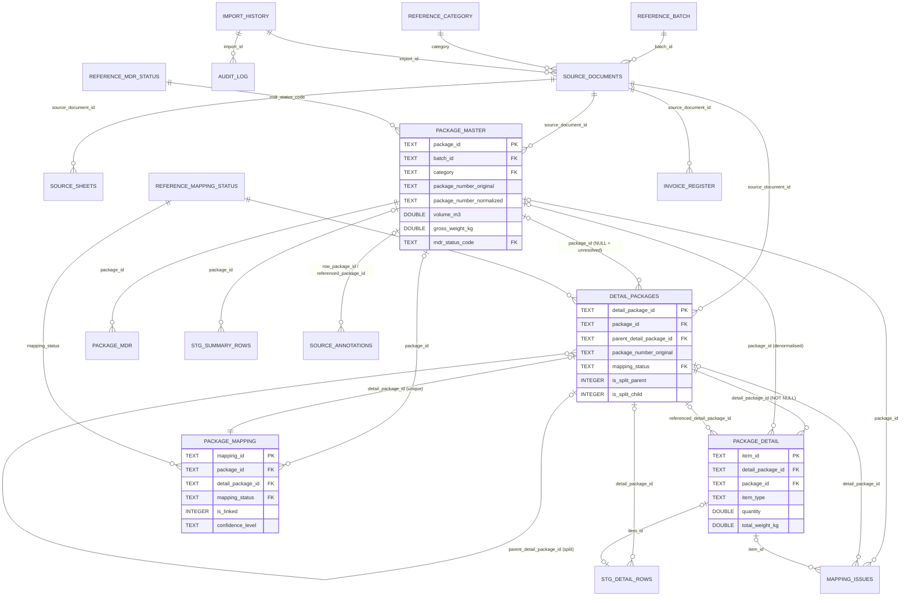

# Logistics Data Model

Logistics Master Database for the Batch 4 / Batch 5 packing lists (categories P3 and P5).
Delivered as SQLite (`output/MASTER_LOGISTICS_DATABASE.sqlite`). The design is PostgreSQL-compatible.

> Field-level definitions are in [LOGISTICS_DATA_DICTIONARY.md](LOGISTICS_DATA_DICTIONARY.md). It is generated from
> `etl/lpl/schema.py`, which is the single source of truth for the DDL, the dictionary and the export column order.

---

## 1. Business objective

Have one controlled register of every package shipped in Batch 4 and Batch 5. Logistics, site receiving and project
controls can use it to answer these questions without opening four workbooks:

* Which packages were shipped, under which batch, category and invoice?
* What does each package physically contain (material lines, drawings, equipment tags)?
* Is the Summary Packing List consistent with the Detail Packing List (identity, dimensions, weights, invoice)?
* Which packages are missing, split, carried over between batches, or still need review?

## 2. Layered architecture


| Layer | Purpose | Tables |
|---|---|---|
| REFERENCE | Lookups for filters and legends | REFERENCE_BATCH, REFERENCE_CATEGORY, REFERENCE_MAPPING_STATUS, REFERENCE_MDR_STATUS |
| LINEAGE | Register of source files and worksheets | SOURCE_DOCUMENTS, SOURCE_SHEETS |
| RAW | Every non-blank source row, unmodified (JSON of cell values) plus its row classification | STG_SUMMARY_ROWS, STG_DETAIL_ROWS, SOURCE_ANNOTATIONS |
| CORE | Normalised master data and relationships | PACKAGE_MASTER, PACKAGE_MDR, DETAIL_PACKAGES, PACKAGE_DETAIL, PACKAGE_MAPPING, INVOICE_REGISTER |
| ANALYTICS | Logistics readiness per package (gates, Readiness Index, status, next action) | PACKAGE_READINESS, REFERENCE_READINESS_STATUS (see [LOGISTICS_READINESS_GUIDE.md](LOGISTICS_READINESS_GUIDE.md)) |
| CONTROL | Exceptions, validation, transformation log, run history | MAPPING_ISSUES, DATA_QUALITY_CHECKS, SERIES_REGISTER, CHANGE_LOG, DATA_DICTIONARY, IMPORT_HISTORY, AUDIT_LOG |

The raw and normalised data are kept separate on purpose. Each core record points back to its raw row, so any value
can be traced to the original cell. Nothing in the core layer overwrites a source value. Normalised values are stored
in separate `*_normalized` / `*_code` columns.

## 3. Entity-relationship diagram



## 4. Drill-down hierarchy

```
REFERENCE_BATCH (B4, B5)
 └─ REFERENCE_CATEGORY (P3, P5)           one SOURCE_DOCUMENT per Batch x Category
     └─ PACKAGE_MASTER                    Summary Packing List row          (1,153)
         └─ DETAIL_PACKAGES               package block in a Detail sheet   (1,163)
             │   └─ DETAIL_PACKAGES        split sub-package blocks (parent_detail_package_id)
             └─ PACKAGE_DETAIL            material item line                (16,943)
```

| Relationship | Cardinality | Rule |
|---|---|---|
| Batch x Category → SOURCE_DOCUMENTS | 1 : 1 | One workbook per batch and category (manifest). |
| SOURCE_DOCUMENTS → PACKAGE_MASTER | 1 : N | Every Summary row with a Package No. |
| PACKAGE_MASTER → DETAIL_PACKAGES | 1 : 0..N | 1:1 normally. 1:N for split packages (parent manifest block + sub-package blocks). 0 when no detail exists. |
| DETAIL_PACKAGES → DETAIL_PACKAGES | 1 : 0..N | `parent_detail_package_id` links sub-packages to the manifest block that lists them. |
| DETAIL_PACKAGES → PACKAGE_DETAIL | 1 : 0..N | `detail_package_id` is NOT NULL, so there are no orphan items. |
| PACKAGE_DETAIL → PACKAGE_MASTER | N : 0..1 | `package_id` is copied from the block once the block is resolved, for one-hop reverse navigation. |
| DETAIL_PACKAGES → PACKAGE_MAPPING | 1 : 1 | Every block has exactly one mapping row. Summary packages without detail also get a row (UNMATCHED_SUMMARY). |

## 5. Keys and identity

* **Surrogate keys, deterministic.** Ids are hashes of business keys, never random:
  * `package_id = PKG-<batch><cat>-<sha1(package_number_normalized, occurrence)[:8]>`
  * `detail_package_id = DPK-<batch><cat>-<sha1(sheet, package_number_normalized, occurrence)[:8]>`
  * `item_id = ITM-<batch><cat>-<sha1(detail_package_id, line_seq)[:10]>`

  Re-running on the same files gives identical ids. This was verified: two consecutive runs produced identical id sets
  for packages, blocks, items and mappings. Inserting a row elsewhere in a sheet does not change existing ids. Ids are
  checked for collisions on every run.
* **Raw package numbers are never primary keys.** They stay in `package_number_original`, untouched.
  `package_number_normalized` is the indexed matching/search key.
* **Unique constraints** stop double imports: (`source_document_id`, `source_sheet`, `source_row`) on PACKAGE_MASTER and
  PACKAGE_DETAIL, (`source_document_id`, `source_sheet`, `source_header_row`) on DETAIL_PACKAGES, (`detail_package_id`,
  `line_seq`) on PACKAGE_DETAIL, and `detail_package_id` on PACKAGE_MAPPING.

## 6. Business rules embedded in the model

| Id | Rule |
|---|---|
| BR-01 | Original identifiers are immutable. Matching uses `*_normalized` only. |
| BR-02 | A Detail block is linked (`package_id` set) only for status EXACT_MATCH, NORMALIZED_MATCH, SPLIT_PACKAGE or CONFIRMED_ALIAS. CANDIDATE_MATCH / MANUAL_REVIEW are proposals stored in PACKAGE_MAPPING only. |
| BR-03 | One Summary package may own several Detail blocks (split packages). Sub-packages are linked only when the parent manifest block lists them. |
| BR-04 | Manifest lines in a parent block (`item_type = SUB_PACKAGE_REFERENCE`) point to the sub-package block and are excluded from material quantity/weight analytics, to avoid double counting. |
| BR-05 | Package weights (`DETAIL_PACKAGES.net/gross_weight_kg`, `PACKAGE_MASTER.*_weight_kg`) and item weights (`PACKAGE_DETAIL.unit/total_weight_kg`) are separate measures and are never summed together. |
| BR-06 | Metadata rows (title, Project Name, Shipper/Invoice, headers), TOTAL rows, unlabelled subtotal rows and empty pre-numbered template rows are never material items. They remain visible in STG_DETAIL_ROWS with their class. |
| BR-07 | No aggregation of item lines. Identical descriptions stay separate rows. |
| BR-08 | Every discrepancy is written to MAPPING_ISSUES with severity and proposed resolution. No value is silently corrected. |
| BR-09 | Manual mapping decisions live in `config/mapping_overrides.csv`. They are re-applied on every run and recorded in PACKAGE_MAPPING (`reviewed_by`, `reviewed_at`, `review_decision`). |
| BR-10 | The Summary invoice number is treated as governing for a workbook. Differing Detail-block invoices are kept as written and flagged (R05). |

## 7. Refresh strategy

The ETL rebuilds the database into a temporary file inside one transaction, with foreign keys deferred and checked at
commit. It then runs `PRAGMA foreign_key_check` and `integrity_check` and swaps the file in atomically. If anything
fails, the previous database is left untouched. A failed run is appended to its IMPORT_HISTORY when possible.
`IMPORT_HISTORY` and `AUDIT_LOG` rows from earlier runs are carried over. All other tables are a full refresh from the
four source files. Deterministic ids make this equivalent to an idempotent upsert.

## 8. Views (query layer for the web app)

| View | Level | Content |
|---|---|---|
| `v_dashboard_kpi` | 1 | KPI tiles: packages, detail packages, items, volume, weights, linked/unlinked, open issues |
| `v_batch_category_summary` | 1–3 | Per batch x category: packages, volume, N.W., G.W., detail blocks, split sub-packages, items, MDR APV, inspected |
| `v_mdr_status_distribution`, `v_mapping_status_distribution` | 1 | Distribution charts |
| `v_package_list` | 4 | Summary grid with roll-ups (linked blocks, items, roll-up mapping status, open issues) |
| `v_detail_package_list` | 5 | Linked blocks with summary/parent numbers |
| `v_material_items` | 6 | Items with detail and summary package numbers (reverse navigation) |
| `v_package_relationships` | 5 | All mapping rows including unlinked proposals |
| `v_open_issues` | Review | Open exceptions with severity rank |
| `v_search_index` | Search | Union of package / detail / item search text |
| `v_readiness_summary`, `v_readiness_by_system`, `v_readiness_status_distribution`, `v_receiving_curve` | Readiness | Logistics readiness KPIs, status split and site receiving S-curve |

The view SQL avoids engine-specific functions (no GROUP_CONCAT / STRING_AGG), so it runs unchanged on PostgreSQL.

## 9. PostgreSQL migration

1. `psql -f sql/schema.sql` (types are `TEXT`, `INTEGER`, `DOUBLE PRECISION`, `DATE`, `TIMESTAMP`. `IF NOT EXISTS` is supported).
2. Load the tables in `LOAD_ORDER` (see schema.py) with `\copy <TABLE> FROM 'output/csv/<TABLE>.csv' CSV HEADER`. The
   CSVs are UTF-8 without BOM, with empty fields for NULL.
3. Optional: `CREATE EXTENSION pg_trgm` plus a GIN trigram index on `v_search_index.search_text` (materialise it), or
   on `PACKAGE_MASTER.package_number_normalized` and `PACKAGE_DETAIL.description_en`, for fast `LIKE '%x%'` search.
4. Keep the ETL as the only writer. The app reads views and, in a later phase, writes review decisions to a review
   table (see the web-app guide).

## 10. Power BI semantic model (optional consumer)

| Power BI table | Source | Role |
|---|---|---|
| Dim Batch / Dim Category / Dim MDR Status / Dim Mapping Status | REFERENCE_* | Dimensions (single-direction filters) |
| Dim Document | SOURCE_DOCUMENTS | Dimension (invoice, PO, ports) |
| Fact Package | PACKAGE_MASTER (or `v_package_list`) | Package-grain fact: volume, N.W., G.W., counts |
| Fact Detail Package | DETAIL_PACKAGES | Block-grain fact, related to Fact Package on `package_id` (many-to-one) |
| Fact Item | PACKAGE_DETAIL filtered `item_type = "MATERIAL"` | Item-grain fact, related on `detail_package_id` |
| Fact Issue | MAPPING_ISSUES | Exception fact, related on `package_id` / `detail_package_id` |

Example measures:

```DAX
Packages              = COUNTROWS ( 'Fact Package' )
Gross Weight (t)      = DIVIDE ( SUM ( 'Fact Package'[gross_weight_kg] ), 1000 )
Volume (m3)           = SUM ( 'Fact Package'[volume_m3] )
% Packages Linked     = DIVIDE ( CALCULATE ( [Packages], 'Fact Package'[package_mapping_status] <> "UNMATCHED_SUMMARY" ), [Packages] )
% MDR Approved        = DIVIDE ( CALCULATE ( [Packages], 'Fact Package'[mdr_status_code] = "APV" ), [Packages] )
% Inspected           = DIVIDE ( CALCULATE ( [Packages], NOT ISBLANK ( 'Fact Package'[inspection_date_original] ) ), [Packages] )
Open HIGH Issues      = CALCULATE ( COUNTROWS ( 'Fact Issue' ), 'Fact Issue'[severity] = "HIGH", 'Fact Issue'[resolution_status] = "OPEN" )
Material Lines        = COUNTROWS ( 'Fact Item' )
```

Use drillthrough pages Package → Detail Package → Items on `package_id` / `detail_package_id`. Use a tooltip page
that shows package dimensions, MDR and mapping status. Import mode is enough at this volume (about 17k item rows).
