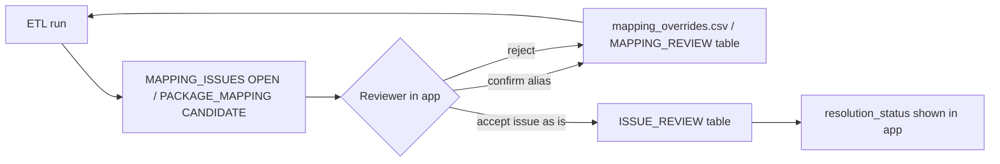

# Logistics Web App - Implementation Guide

This guide shows how to build the Logistics Data Explorer on top of the Logistics Master Database. It covers the
**data foundation only**: views, queries, API contract and workflows. Building the user interface is out of scope for
this phase.

Every query referenced as `Qnn` is in [`sql/app_queries.sql`](../sql/app_queries.sql). Each one is executed against the
generated database by `etl/test_app_queries.py`, and all of them currently pass.

> **Implemented:** the *Logistics Readiness* dashboard (`logistics-readiness.html` in the repository root) is the
> first working module built on this foundation. It runs without a server. See
> [LOGISTICS_READINESS_GUIDE.md](LOGISTICS_READINESS_GUIDE.md).

---

## 1. Business objective

* A single place to find any shipped package by number, equipment tag, MDR, RFS or description, then drill down to its
  physical contents.
* A trustworthy picture: every number traces back to a workbook, sheet and row, and every inconsistency is visible
  rather than hidden.
* A base for site material receiving: RFS, inspection, laydown area and received quantity.

## 2. Technical methodology

| Concern | Approach |
|---|---|
| Data store | SQLite file for the pilot (19 MB). PostgreSQL for multi-user deployment, with the same schema and views (`sql/schema.sql`) |
| Data refresh | Batch ETL (`python3 -I etl/run_etl.py`). Atomic database swap. Deterministic ids, so URLs and bookmarks stay valid across refreshes |
| Query layer | Read-only SQL views (`v_*`). The app does not join raw tables for standard screens |
| Write-back | Review decisions only (mapping confirmations and issue status). See section 6 |
| Lineage | `source_document_id`, `source_sheet` and `source_row` on every core row. Raw row JSON in `STG_*` tables |

## 3. Navigation levels → data

| Level | Screen | Data source | Query |
|---|---|---|---|
| 1 | **Logistics Dashboard**: KPI tiles (packages 1,153 · detail packages 1,163 · material items 16,933 + 10 manifest lines · volume · N.W. · G.W. · open issues), Batch 4 / 5 and P3 / P5 cards, MDR status and mapping status charts | `v_dashboard_kpi`, `v_batch_category_summary`, `v_mdr_status_distribution`, `v_mapping_status_distribution` | Q01–Q04 |
| 2 | **Batch selection** | `REFERENCE_BATCH` + counts | Q05 |
| 3 | **Category selection** | `REFERENCE_CATEGORY` + counts for the chosen batch | Q06 |
| 4 | **Summary Packing List** grid: search (package no., equipment, description, MDR), filters (MDR status, RFS, volume range, G.W. range), sort, pagination, Excel export | `v_package_list` | Q07, Q08, Q24 |
| 5 | **Package detail**: header card (dimensions, volume, N.W., G.W., MDR, RFS, inspection, remark, site annotation, source document), linked detail blocks (parent manifest + split sub-packages), mapping status and relationships, exceptions | `v_package_list`, `v_detail_package_list`, `v_package_relationships`, `MAPPING_ISSUES` | Q09–Q12 |
| 6 | **Material items** per detail block, or all materials of the package | `v_material_items` | Q13, Q14 |
| ↩ | **Reverse navigation**: item → detail block → Summary package → batch/category | `v_material_items` + `PACKAGE_MASTER` | Q15 |

### Display rules

* **Split packages.** On Level 5, show the parent manifest block first, then its sub-packages indented
  (`is_split_parent`, `is_split_child`, `parent_detail_package_number`). On Level 6, exclude
  `item_type = 'SUB_PACKAGE_REFERENCE'` from quantity and weight totals. Those lines are pointers to the sub-packages
  (`referenced_detail_package_id`); render them as links.
* **Package weight vs item weight.** Show N.W./G.W. from the package. Show Σ item total weight separately as
  `item_weight_sum_kg`, labelled "sum of item lines". Never mix the two.
* **Unresolved blocks.** A block with `package_id IS NULL` (currently 1: `HDCZ-K-5-2/8`) must stay reachable. List it
  under the batch/category with its CANDIDATE status and a link to the proposed Summary package (Q11 / Q21).
* **Original vs normalised.** Display `package_number_original`. Search on `package_number_normalized` (upper-case, no
  spaces, full-width converted), so `jljx-4-34(3)` finds `JLJX-4-34（3）/34`.
* **Multi-value cells.** `inspection_date` is NULL when the source cell holds several dates. Display
  `inspection_date_original` in that case.

## 4. Proposed REST API (read side)

| Method & path | Returns | Query |
|---|---|---|
| `GET /api/dashboard` | KPI object + batch/category cards + distributions | Q01–Q04 |
| `GET /api/batches` | batches with counts | Q05 |
| `GET /api/batches/{batch}/categories` | categories with counts | Q06 |
| `GET /api/packages?batch=&category=&q=&mdr=&rfs=&vol_min=&vol_max=&gw_min=&gw_max=&sort=&page=&size=` | paged package list + `total` | Q07 + Q08 |
| `GET /api/packages/{package_id}` | header card | Q09 |
| `GET /api/packages/{package_id}/detail-packages` | linked blocks (tree) | Q10 |
| `GET /api/packages/{package_id}/relationships` | mapping rows incl. proposals | Q11 |
| `GET /api/packages/{package_id}/issues` | exceptions | Q12 |
| `GET /api/packages/{package_id}/items` | all materials of the package | Q14 |
| `GET /api/detail-packages/{detail_package_id}/items?page=&size=` | items of a block | Q13 |
| `GET /api/items/{item_id}` | item + breadcrumb (reverse navigation) | Q15 |
| `GET /api/search?q=` | mixed hits (package / detail / item) | Q16 |
| `GET /api/trace/package/{package_id}` · `/api/trace/detail-package/{id}` | raw source rows (JSON of cells) | Q17, Q18 |
| `GET /api/issues?severity=&type=&page=` | review queue | Q19 |
| `GET /api/relationships/split` · `/api/relationships/candidates` | split tree · candidates | Q20, Q21 |
| `GET /api/invoices` · `/api/series` · `/api/quality` · `/api/imports` | control screens | Q22, Q23, Q25, Q26 |
| `GET /api/export/packages.xlsx?batch=&category=&…` | streamed export of the filtered grid | Q24 |

Implementation notes:

* **Sorting.** Accept only whitelisted column names, mapped to SQL identifiers. Never interpolate user input.
* **Pagination.** `LIMIT/OFFSET` is fine at this volume (≤ 17k rows). Use keyset pagination (`ORDER BY source_sn,
  package_id`) if the database grows by an order of magnitude.
* **Search.** SQLite: `LIKE` on `v_search_index.search_text` is adequate. An FTS5 table can be added later.
  PostgreSQL: materialise `v_search_index` and add a `pg_trgm` GIN index.
* **Export to Excel.** Run the same filter SQL without LIMIT (Q24), stream it with openpyxl write-only or xlsxwriter,
  and keep `package_number_original` as text.
* **Caching.** The data only changes when the ETL runs. Cache responses keyed by
  `IMPORT_HISTORY.source_fingerprint` (latest successful run).

## 5. Source document tracing

Every grid row exposes a "Source" action:

1. `source_document_id` → `SOURCE_DOCUMENTS` (file name, SHA-256, invoice, PO).
2. `source_sheet` and `source_row` (or `source_header_row` / `source_block_start_row`…`source_block_end_row` for
   blocks) give the exact Excel location.
3. `STG_*_ROWS.raw_values_json` shows the cells as read (Q17 / Q18). This is useful when a normalised value is
   questioned.

## 6. Mapping exception review workflow

* **Phase 1 (now):** decisions go into `config/mapping_overrides.csv` (version-controlled, re-applied on every run).
* **Phase 2 (app):** add two app-owned tables that the ETL reads but never truncates:
  * `MAPPING_REVIEW(detail_package_id, summary_package_id, decision, reviewed_by, reviewed_at, note)`. It replaces the
    CSV, with the same semantics.
  * `ISSUE_REVIEW(issue_id, resolution_status, reviewed_by, reviewed_at, note)`. Issue ids are deterministic, so a
    review survives re-runs while the underlying condition persists.
* Show the evidence for every candidate: `PACKAGE_MAPPING.evidence_json` holds the attribute-by-attribute comparison
  and alternative candidates.

## 7. Future material-receiving integration (data contract)

The Summary sheets already carry site-receiving signals: `rfs_material_receiving`, `inspection_date`,
`received_quantity` (column headed *Quantity*, filled for B4-P5 and B5-P3) and `remark` (laydown area). The pivot
totals in the source match the model: B4-P5 has 335 inspected packages and B5-P3 has 10.

Proposed extension, keyed on the stable ids:

| Table | Grain | Key fields |
|---|---|---|
| `RECEIVING_EVENT` | package x event | `receiving_id` PK, `package_id` FK, `rfs_number`, `event_type` (ARRIVED, INSPECTED, RELEASED, ISSUED), `event_date`, `laydown_area`, `condition`, `received_qty`, `inspector`, `ncr_number` |
| `RECEIVING_ITEM_CHECK` | item x inspection | `item_id` FK, `receiving_id` FK, `qty_found`, `qty_damaged`, `qty_missing`, `remark` |
| `v_package_receiving_status` | package | last event, status, days since arrival |

Seed `RECEIVING_EVENT` from the current Summary columns. Keep site-entered data out of the ETL-refreshed tables.

## 8. Recommended KPIs

| KPI | Definition | Source |
|---|---|---|
| Packages shipped | count of Summary packages per batch/category | `v_batch_category_summary.packages` |
| Shipped tonnage / volume | Σ G.W. (t), Σ volume (m3) | `v_batch_category_summary` |
| Detail coverage % | packages with ≥ 1 linked block ÷ packages | `v_package_list.package_mapping_status <> 'UNMATCHED_SUMMARY'` (currently 1,152 / 1,153 = 99.9 %) |
| MDR approval % | packages with `mdr_status_code = 'APV'` ÷ packages | `v_mdr_status_distribution` |
| Inspection / receiving progress % | packages with an inspection date ÷ packages | `inspection_date_original IS NOT NULL` |
| Outstanding series packages | Σ `missing_count` (declared n/N not yet listed) | `SERIES_REGISTER` (e.g. ZMZGT-4: 66 of 100 not yet listed) |
| Open HIGH exceptions | count | `v_open_issues` |
| Document consistency % | blocks whose invoice = Summary invoice ÷ blocks | `INVOICE_REGISTER` |

## 9. Reporting structure

| Report | Audience | Content |
|---|---|---|
| Weekly logistics report | Logistics / site receiving | Packages received vs shipped, inspection progress, open HIGH issues, packages pending detail |
| Monthly report | Project controls / PM | Tonnage and volume per batch/category, MDR approval trend, outstanding series |
| Management review / steering committee | Management | KPI tiles, exceptions trend, top risks (invoice inconsistencies, unmatched packages) |
| Data-quality bulletin (per ETL run) | Data owner | `DATA_QUALITY_CHECKS` failures/warnings, new issues since last run (`IMPORT_HISTORY`) |

## 10. Risks and mitigations

| Risk | Mitigation |
|---|---|
| Source format drift (new columns, renamed headers, new sheets) | Columns are mapped by label and sheets auto-detected. Recount checks (C01–C07) fail loudly if anything is missed |
| A fuzzy match is mistaken for confirmed | CANDIDATE / MANUAL_REVIEW are never linked. Linking requires an explicit override |
| Double counting of split packages | Manifest lines are typed `SUB_PACKAGE_REFERENCE` and excluded from material sums |
| Invoice inconsistencies in detail lists | The Summary invoice governs. All deviations are flagged (R05, 381 blocks) for customs follow-up |
| Confidential commercial data (PO, consignee, contents) | Keep the database and source files in a private store with access control. The repository holds code and documentation only |
| SQLite concurrency | Pilot only. Move to PostgreSQL for multi-user write-back |

## 11. Performance and mobile notes

* All filter and join columns are indexed (`batch_id, category`, `package_number_normalized`, `package_id`,
  `detail_package_id`, `mapping_status`, `drawing_number`, `equipment_number`, `mdr_number`).
* Typical screen queries run in milliseconds on the 19 MB SQLite file.
* Mobile layout: the Level 4 grid collapses to cards (package no., type, G.W., MDR badge, mapping badge). Level 5 and 6
  become stacked sections. Search should be the primary entry point on mobile.

## 12. Deployment checklist

1. Run the ETL and confirm `IMPORT_HISTORY.status = 'SUCCESS'` and `checks_failed = 0`.
2. `python3 -I etl/test_app_queries.py` should report `ALL PASSED`.
3. PostgreSQL: `psql -f sql/schema.sql`, then `\copy` each CSV in load order.
4. Point the API at the views. Grant read-only access for the app role and write access only to the review tables.
